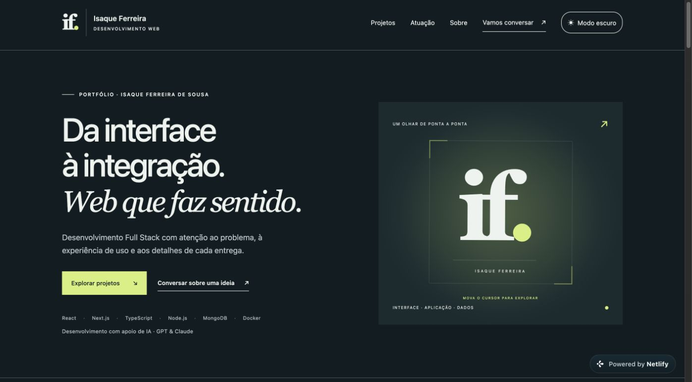

<div align="center">

# Isaque Ferreira de Sousa

**Desenvolvimento Full Stack · Interfaces, APIs e aplicações web**

Da interface à integração. *Web que faz sentido.*

[**Explorar o portfólio ↗**](https://isaque-ferreira.netlify.app/) · [Conversar sobre um projeto](https://isaque-ferreira.netlify.app/#contato)

</div>

[](https://isaque-ferreira.netlify.app/)

## Aplicações com contexto

Este portfólio reúne projetos que desenvolvi e evoluí, com demonstrações dos fluxos, imagens das interfaces e explicações das escolhas técnicas. Cada case apresenta minha participação e o contexto da implementação.

Meu trabalho inclui desenvolvimento de interfaces, integração com APIs e manutenção e evolução de aplicações web.

## Projetos em destaque

| Projeto | O que você encontra no case |
| --- | --- |
| **Custeio** | Gestão de custos e estoque para restaurantes, com integração de pedidos, fichas técnicas e notas de compra. |
| **Cuepoint** | Biblioteca de áudio e vídeo com processamento em segundo plano, acompanhamento de progresso, revisão e compartilhamento de transcrições. |
| **Kairoz Media Studio** | Organização de criativos, ajustes de enquadramento, exportação em lote e integração com uma extensão do Chrome. |
| **FaceLink** | Páginas públicas de links, personalização com prévia e acompanhamento de visitas e cliques. |
| **RealTimeChat** | Conversas em tempo real com presença, recibos de leitura, reenvio e histórico paginado. |
| **Plin** | Clima, previsão, qualidade do ar e consulta de CEP, com mapas, favoritos e troca de unidades. |
| **Soccer-Mania** | Painel de futebol com partidas, classificações, times e jogadores, filtros e paginação. |

[**Ver projetos, vídeos e decisões técnicas →**](https://isaque-ferreira.netlify.app/#projetos)

## Por dentro das decisões

Os cases explicam escolhas que afetam o funcionamento das aplicações, como gerenciamento de estado, cache, processamento assíncrono, recuperação de falhas e comunicação em tempo real.

Os detalhes incluem os limites de cada demonstração e as evidências disponíveis. Exemplos são a reorganização do estado do FaceLink com React Query e MobX e a separação entre aplicação web e worker de mídia no Cuepoint.

## Experiência de navegação

- Temas claro e escuro, com a preferência salva no navegador.
- Layout adaptado a desktop e celular.
- Galerias com capturas e vídeos dos projetos.
- Alternância entre visão geral e decisões técnicas.
- Monograma interativo que respeita a preferência por movimento reduzido.

## Sobre este site

A apresentação foi construída com **HTML, CSS e JavaScript**, usando arquivos estáticos. As tecnologias descritas dentro dos cases correspondem às respectivas aplicações.

A publicação no **Netlify** acompanha a branch `main` deste repositório.

<details>
<summary><strong>Executar e editar o portfólio</strong></summary>

Sirva a pasta do repositório com um servidor HTTP local.

```sh
python3 -m http.server 8080 --bind 127.0.0.1
```

Abra [localhost na porta 8080](http://127.0.0.1:8080).

| Arquivo ou pasta | Conteúdo |
| --- | --- |
| `index.html` | Estrutura da página e apresentação dos projetos |
| `styles.css` | Identidade visual, temas e layout responsivo |
| `script.js` | Navegação dos cases, galerias e interações |
| `conteudo.js` | Descrições, decisões técnicas e referências às mídias |
| `assets/projetos/` | Capturas e vídeos dos cases |
| `netlify.toml` | Diretório de publicação |

</details>

## Vamos conversar

Tem uma aplicação para criar, corrigir ou evoluir? Podemos conversar sobre o problema, o escopo e a entrega.

[WhatsApp](https://wa.me/5561981482674) · [E-mail](mailto:isaqueferreiradesousa@gmail.com) · [LinkedIn](https://www.linkedin.com/in/isaque-ferreira-de-sousa-700902181/)
